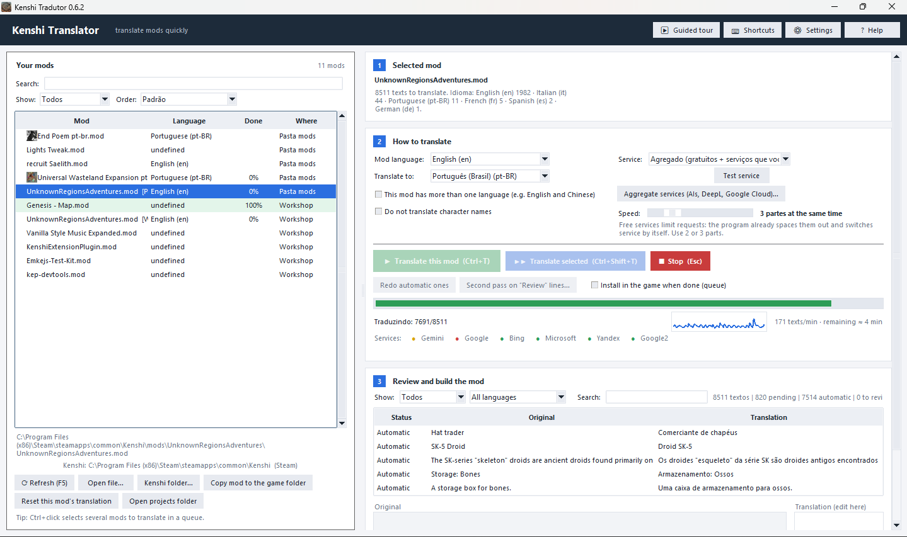
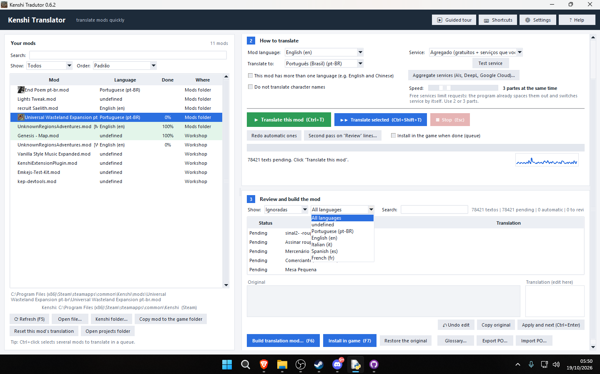
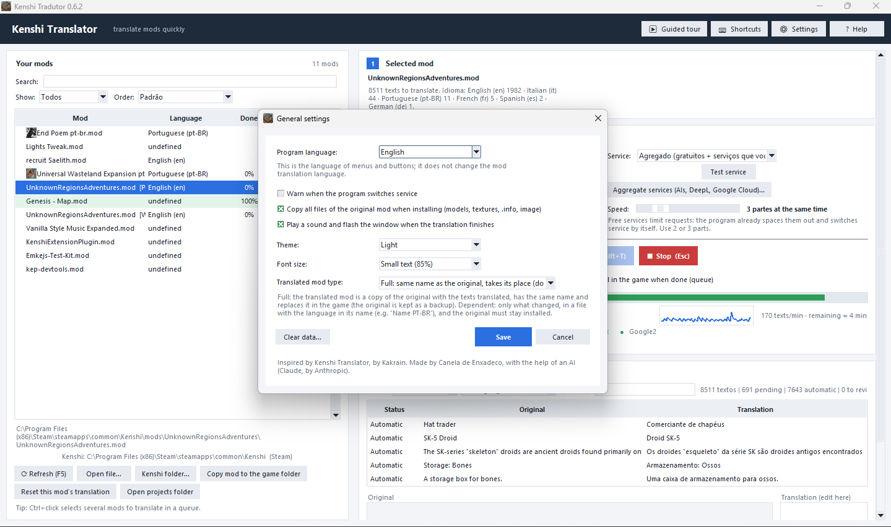
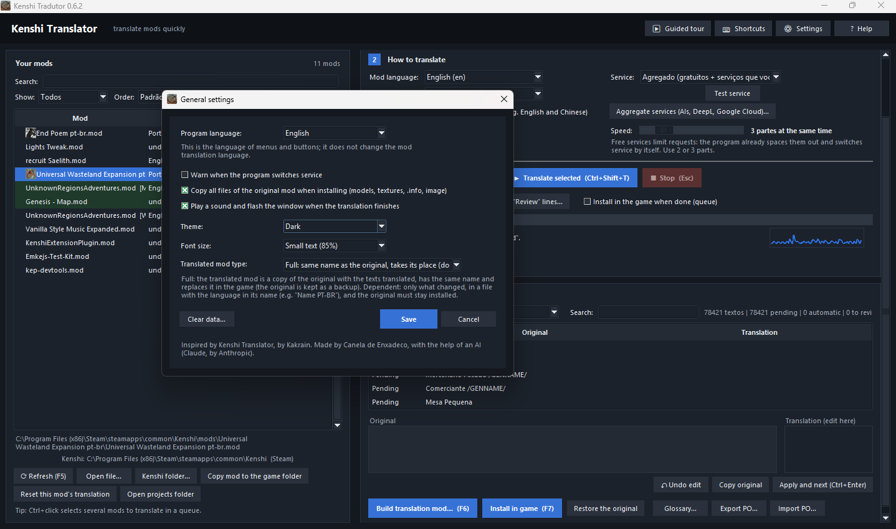

<div align="center">

**🇺🇸 English** · [🇧🇷 Português](README.pt-BR.md)

</div>

<div align="center">

# 🗡️ Kenshi Quick Translator

**Translate Kenshi mods quickly, without breaking the game's codes.**


A Windows desktop program that **reads the `.mod` file**, **translates every text** (dialogue, names, descriptions…), lets you **review it side by side**, and **installs the translation straight into Kenshi** — without ever touching the original file.

<!-- 📸 PUT A MAIN-SCREEN SCREENSHOT HERE: docs/img/main-screen.png -->
<!--  -->

</div>

---

## 📑 Table of contents

- [✨ Highlights](#-highlights)
- [🖼️ Screenshots](#️-screenshots)
- [🚀 Getting started](#-getting-started)
- [🧭 A tour of the window](#-a-tour-of-the-window)
- [🌐 Translation services](#-translation-services)
- [🛡️ How it protects your mod](#️-how-it-protects-your-mod)
- [📝 Reviewing translations](#-reviewing-translations)
- [📦 Install, restore and clear](#-install-restore-and-clear)
- [🎨 Look and comfort](#-look-and-comfort)
- [⌨️ Keyboard shortcuts](#️-keyboard-shortcuts)
- [💻 Command line](#-command-line)
- [🧱 Dependencies](#-dependencies)
- [🔨 Building the `.exe`](#-building-the-exe)
- [🧪 Tests](#-tests)
- [🗂️ Project structure](#️-project-structure)
- [🛠️ How it was made](#️-how-it-was-made)
- [🙏 Credits](#-credits)
- [⚠️ Known limits](#️-known-limits)
- [📜 License](#-license)

---

## ✨ Highlights

| | |
|---|---|
| 🔎 **Detects language from the content** | Works out the language of each mod (even of each individual text) instead of trusting the file name. |
| 🌍 **Mods with more than one language** | A mod with English **and** Chinese? Each text goes to the service with the right source language. |
| 🔁 **Many services in one** | *Aggregate* mode: free Google, Bing, Microsoft and Yandex, plus DeepL, Google Cloud, LibreTranslate and AIs. If one gets blocked, the program switches by itself. |
| 🛡️ **Game codes protected** | Markers such as `/TEAMUP/` are set aside before translating and checked afterwards. |
| ⚡ **Fast** | Parallel batches, translation memory, and repeated text sent only once. |
| 💾 **Never loses your work** | Progress is saved as it goes. Close the program and carry on later. |
| 🧐 **Side-by-side review** | Table with original and translation, a counter of doubtful texts, undo, second pass. |
| 📦 **One-click install** | Puts the translated mod in the game folder, enables it in `mods.cfg`, and keeps the original. |
| ♻️ **Reversible** | The **Restore the original** button puts the mod back as it was. |
| 🗣️ **Interface in 5 languages** | Português, English, Español, Русский and 中文. |

---

## 🖼️ Screenshots

> 📸 *Add your screenshots to the `docs/img/` folder and uncomment the lines below.*

<!--
| Mod list | How to translate |
|---|---|
|  |  |

| Review | Settings |
|---|---|
|  |  |

| Aggregate services | Dark mode |
|---|---|
|  |  |
-->

---

## 🚀 Getting started

### ▶️ Option 1: with the `.exe` (nothing to install)

1. Build the `.exe` as described in [Building the `.exe`](#-building-the-exe) (or download a ready-made one, if there is one under *Releases*).
2. Open `KenshiQuickTranslator.exe`.
3. Pick the mod in the list → pick the language → **Translate this mod**.
4. Review whatever you like → **Install in game**.

### 🐍 Option 2: from source

1. Install **Python 3.10 or newer** from [python.org](https://www.python.org/). During setup, tick **"Add python.exe to PATH"**.
2. Double-click `instalar.bat` (only once).
3. Double-click `abrir.bat`.

> 💡 If Kenshi is not found automatically, use **Kenshi folder…**. For mods outside the installation, use **Open file…**.

### 📋 Step by step for a Workshop mod

1. In the list, select the mod shown as **Workshop**.
2. Click **Copy mod to the game folder** (it copies the mod's whole folder, models and textures included; the Workshop copy is not changed).
3. Select the same mod again, now on the **Mods folder** line.
4. Choose the language and click **Translate this mod**.
5. When it finishes, click **Install in game**.
6. Open Kenshi (or the FCS) and check.

---

## 🧭 A tour of the window

On the left is the **list of your mods**; on the right, **three steps**.

### 📚 Mod list

- 🖼️ **Icon** for each mod (PNG, JPG, GIF, BMP), when the mod ships an image.
- 🌐 **Language** detected from the content, with its code: `English (en)`, `Chinese (zh)`…
- 📊 **Done**: how much is already translated, per mod and target language.
- 📍 **Where**: *Mods folder* or *Workshop*.
- 🔎 Search, filters (all / Workshop / mods folder…) and sorting.
- ✅ Multi-select with **Ctrl+click** to translate as a **queue**.
- 🧩 Two mods with the **same name** (Steam and local folder) are handled separately, each with its own project.

### 1️⃣ Selected mod

Shows the name, **how many texts need translating**, and **how many texts of each language** were found (e.g. `31225 texts to translate. Language: Chinese (zh) 20375 · English (en) 15 · Japanese (ja) 11…`).

### 2️⃣ How to translate

- 🌐 **Mod language** (or *Detect automatically*) and **Translate to**.
- ☑️ **This mod has more than one language** (e.g. English and Chinese). The program suggests it by itself when it detects that.
- ☑️ **Do not translate character names**.
- 🔧 **Service** and the **Test service** button.
- ⚙️ **Aggregate services…** (AIs, DeepL, Google Cloud…).
- 🏎️ **Speed**: 1 to 12 parts at the same time.
- ▶️ **Translate this mod** · ▶▶ **Translate selected** · ⏹ **Stop**.
- 🔁 **Redo automatic ones** and **Second pass on "Review"**.
- ☑️ **Install in the game when done (queue)**.
- 📈 **Speed graph** (texts per minute, with the peak) next to the progress bar.

### 3️⃣ Review and build the mod

- 🗃️ Table with **State**, **Original** and **Translation**.
- ✏️ Edit box: fix a text and press **Ctrl+Enter** to apply and move to the next one.
- 🔎 Search, plus filters by state and by source language.
- 🧮 Counters: `31225 texts | 0 pending | 31021 automatic | 1 to review`.
- 🛠️ **Build translation mod…** · **Install in game** · **Restore the original** · **Glossary…** · **Export PO…** · **Import PO…**

---

## 🌐 Translation services

### 🆓 Free (no key), used together in **Aggregate** mode

| Service | Note |
|---|---|
| Google | fast, the most used |
| Google 2 | a second Google route, with its own limit |
| Bing | |
| Microsoft | |
| Yandex | |

> ⚠️ These are **unofficial** endpoints: they can rate-limit or change at any time. The aggregate reduces blocking, but cannot prevent it.

### 🔑 With your own key

| Service | Note |
|---|---|
| DeepL | good quality (the free key ends in `:fx`) |
| Google Cloud Translation | v2 (API key) and v3 (service account or `gcloud`) |
| LibreTranslate | your own server, key optional |
| OpenAI-format AIs | Gemini, DeepSeek, OpenRouter, Groq, Qwen and anything compatible: you provide URL, model and key |
| Simulated | doesn't really translate; for testing the program |

### 🧠 How the aggregate works

- 🔄 **Round-robin**: each batch starts with a different service, splitting the work.
- ⏸️ **Quarantine**: a service that fails (429, 403, 5xx, timeout, bad answer) is taken out of rotation for 1 minute, doubling with each consecutive failure (max. 10 min).
- 🧩 **Partial failure**: what already came back is kept, and the rest of the batch goes to the next service.
- 🚦 **Per-service rate limiter**: spaces out requests to avoid being blocked (conservative values, not official ones).
- 📣 **Notices in your language** when it switches service (can be turned off in Settings).
- 🗝️ **Several keys** for the same service, separated by `;`, to share the load.
- 🔍 **"Aggregate services" window**: tick/untick, reorder with ▲▼, add services with keys, pick ready-made models, and use **Test all**.
- ⏳ If every service is down, the program waits and retries; only then does it stop, keeping everything already translated.

---

## 🛡️ How it protects your mod

| Protection | What it does |
|---|---|
| 🏷️ **Game markers** | `/TEAMUP/`, `/BROTHER/`, `/BASTARD/s`… are protected before going to the service and checked afterwards. If one gets lost, the program tries other ways; if that fails, it keeps the original and marks the line **Review**. No translation with a lost marker is saved. |
| 📖 **Glossary** | Terms that must always come out the same, or never be translated. The built-in ones are suggestions; edit freely. |
| 🧑 **Character names** | Left as they are (you can untick this). |
| 🧬 **Text fields** | Like the original program, it translates every text field except those in `translator_blacklist.txt` (11 technical fields, such as `bone name` and `anim name`). |
| 🧯 **Code filter** | Fields that look like code (file name, path, glued identifier, lone lowercase word) stay in English, and the program tells you which. To force a field to be translated, use `translator_liberados.txt`. |
| 💾 **Saved projects** | Updating the mod doesn't erase your work. If the original text changed, the line comes back as **Review**. |
| 🔬 **Final check** | The generated file is read back and compared with the project. If anything is wrong, it **does not install**. |
| 🔒 **Original untouched** | The original `.mod` is never changed when building. When installing, it is kept as `<name>.mod.original`. |

---

## 📝 Reviewing translations

- ⚠️ **Doubtful counter** (`⚠ N doubtful`) and **Doubtful** filter: gathers texts in *Review*, those whose markers don't match, and those "translated" identically to the original.
- 🎨 **Coloured markers** in both fields: green = matches; red = missing or extra.
- ↶ **Undo edit** (Ctrl+Shift+Z), up to 200 levels per open mod.
- 🔁 **Second pass on "Review"**: redoes only those texts with another service and only replaces when the result gets better; whatever you reviewed is not changed.
- 🌐 **Source-language filter** (appears when the mod has 2+ languages).
- 📤📥 **Export/Import `.po`**: edit in Poedit and bring it back.
- 🧰 **Redo automatic ones**: translates the automatic translations again (what you reviewed by hand is kept) and backs up the project first.

---

## 📦 Install, restore and clear

### 📥 Install in game

- Puts the translated mod in `Kenshi/mods/<name>/` with the **same name** as the original (it takes the original's place in the game).
- Keeps the original as `<name>.mod.original`, once.
- Makes sure the mod is enabled in `data/mods.cfg`, **with a backup** of `mods.cfg`.
- For a Workshop mod, first use **Copy mod to the game folder**: the whole folder is copied (models, textures, `.info`, image).
- Translating later into **another language** simply swaps the installed translation; the program always reads the original.

### 🧬 Two kinds of translated mod (⚙ Settings)

| Kind | What it is |
|---|---|
| **Complete** (default) | A copy of the original with the texts translated, same name, replaces the original in the game. Doesn't depend on the original. |
| **Dependent** | Only what changed, in a `Name LANG.mod` file in its own folder, enabled right after the original in `mods.cfg`. The original must stay installed. |

### ↩️ Restore the original

Button next to **Install in game**: puts the original `.mod` back and leaves the translation beside it as `<name>.mod.traduzido`. The `.original` copy is kept.

### 🧹 Clear data

Under **Settings → Clear data…** you choose what to delete, seeing the count and size of each item:

- 💾 Saved translations (each mod's progress)
- 🗄️ Project backups
- 🧠 Translation memory
- 🌐 Languages detected in mods
- 📖 Glossary
- ⚙️ Settings and service keys

> 🔒 It only deletes the **program's own data**. The mods, `mods.cfg` and the `.original` copies in the Kenshi folder are **not touched**.

### 🗑️ Reset one mod's translation

The **Reset this mod's translation** button deletes that mod's saved progress (with a backup copy). To open the projects folder: **Open projects folder**.

### 📁 Where the data lives

`%APPDATA%\KenshiQuickTranslator\` — projects (`projetos\<Mod>.<language>.ktproj.json`), translation memory (`memoria.sqlite`), settings (`config.json`), glossary and the field lists.

---

## 🎨 Look and comfort

- 🗣️ **Program language**: Português, English, Español, Русский, 中文 (this is the language of menus, not of the mod translation).
- 🌗 **Theme**: light, dark or automatic (follows Windows).
- 🔠 **Font size**: 85% to 150%.
- 🧭 **Guided tour** on first launch (the **Step by step** button at the top reopens it any time).
- 💬 **Tooltips** when you hover over fields.
- 📉 **Speed graph** while translating.
- 🔔 Sound and a flashing window when a translation or queue finishes (optional).
- 🪟 The window remembers its size, position and last selection; on a narrow window, the mod list becomes a panel that opens and closes (F9).
- 🚨 **Errors with buttons**: if the service breaks midway, the window offers **Try again** (resumes where it stopped) and **Change service…**.

---

## ⌨️ Keyboard shortcuts

| Shortcut | Action |
|---|---|
| `Ctrl+T` | translate this mod |
| `Ctrl+Shift+T` | translate the selected mods |
| `Esc` | stop |
| `F5` | refresh the mod list |
| `F6` | build the translation mod |
| `F7` | install in game |
| `Ctrl+Enter` | apply the edit and go to the next |
| `Ctrl+Shift+Z` | undo the last edit |
| `Ctrl+F` / `Ctrl+Shift+F` | search the texts / the mod list |
| `F9` | open/close the list (narrow window) |
| `Ctrl +` / `Ctrl −` / `Ctrl+0` | increase / decrease / reset the font size |

---

## 💻 Command line

```bash
kenshi-quick-translator scan                                  # list installed mods
kenshi-quick-translator info "Kaizo.mod"                      # texts and detected languages
kenshi-quick-translator translate "Kaizo.mod" --provider deepl --key YOUR_KEY --workers 6 --out output
kenshi-quick-translator translate "Mixed.mod" --sources en,zh --provider deepl --key YOUR_KEY
kenshi-quick-translator translate "Kaizo.mod" --provider simulado --install
kenshi-quick-translator po-export "Kaizo.mod" --out Kaizo.po  # edit in Poedit
kenshi-quick-translator po-import "Kaizo.mod" --po Kaizo.po
```

---

## 🧱 Dependencies

| What | What for | Required? |
|---|---|---|
| 🐍 **Python 3.10+** | running the program | yes (not needed if you use the `.exe`) |
| 🖼️ **Tkinter** | the window | yes (ships with Python on Windows) |
| 🧩 [`kenshi-translator-toolkit`](https://github.com/AlexPrestes/kenshi-translator-toolkit) `>= 1.1.1` | **reading and writing Kenshi's `.mod` format** | yes (installed by `instalar.bat`) |
| 🎨 **Pillow** | JPG mod icons and large images | no (optional; `pip install pillow`) |
| 🔐 **cryptography** | service-account login for Google Cloud v3 | no (only if you use that option) |
| ☁️ **gcloud** | alternative Google Cloud v3 login | no |
| 📦 **PyInstaller** | building the `.exe` | only if you want to build the `.exe` |

Manual install:

```bash
python -m pip install .            # installs the program and the toolkit
python -m pip install pillow       # optional
```

> 🌐 The program needs internet to translate (the services are in the cloud). Reading, reviewing and installing work offline.

---

## 🔨 Building the `.exe`

1. Install Python (see above).
2. Double-click **`gerar-exe.bat`**.
3. The result is in `lancamento\KenshiQuickTranslator\`: the `.exe` (built without UPX, to reduce antivirus false alarms), plus the `LEIA-ME`, `LICENSE` and `LICENCAS-TERCEIROS` files.

> 🛡️ **Antivirus:** a Python `.exe` made with PyInstaller is sometimes flagged by mistake. If you prefer, run from source.
> 🔓 PyInstaller **does not encrypt**: the `.exe` holds compiled code, which is harder to read than the `.py` but can be recovered.

---

## 🧪 Tests

```bash
python -m unittest discover -s tests -v                        # full suite (203 tests)
KENSHI_SAMPLE_MOD="path/to/mod.mod" python -m unittest discover -s tests   # with a real mod
xvfb-run -a python tests/gui_smoke61.py                        # real window (Linux, virtual screen)
python tests/bench_large.py --texts 50000 --delay 0 --workers 6  # large mod
```

The tests cover reading and writing the `.mod`, markers, services (using **fake** HTTP servers), round-robin and quarantine, translation memory, projects, interface languages, and the window on a virtual screen.

**The program's own speed** (simulated service, 0.05 s per request, synthetic mod of 20,000 texts):

| Parallel parts | 1 | 3 | 6 | 12 |
|---|---|---|---|---|
| Time | 38.5 s | 13.2 s | 6.8 s | 3.6 s |

> This measures the program, **not** the services. In practice, each service's limits decide how long it takes.

---

## 🗂️ Project structure

```
kenshi-quick-translator/
├── iniciar.py · abrir.bat · instalar.bat · gerar-exe.bat
├── KenshiQuickTranslator.spec        # PyInstaller recipe
├── pyproject.toml
├── kenshi_quick_translator/
│   ├── gui.py                 # the window (Tkinter)
│   ├── session.py             # ties window, services, project and game together
│   ├── core.py                # translates, builds, checks and installs the mod
│   ├── project.py             # saved project per mod/language
│   ├── fields.py              # which text fields are included (list + code filter)
│   ├── markers.py             # protection of game codes (/TEAMUP/…)
│   ├── freeproviders.py       # free services and the aggregate mode
│   ├── providers.py           # DeepL, Google Cloud v2, LibreTranslate, simulated
│   ├── services.py            # AIs (OpenAI format) and Google Cloud v3
│   ├── langdetect.py          # per-text language, no external model
│   ├── memory.py              # translation memory (SQLite)
│   ├── glossary.py            # glossary
│   ├── review.py              # doubtful texts, coloured markers, undo
│   ├── restore.py             # restore the original
│   ├── cleanup.py             # clear the program's data
│   ├── locate.py              # finds Kenshi, the Workshop and the mods
│   ├── i18n*.py               # interface in 5 languages
│   ├── ui_*.py                # interface parts (actions, state, tour, icons)
│   └── cli.py                 # command line
└── tests/                     # 203 tests + window tests
```

---

## 🛠️ How it was made

This project started from a simple wish: **translate Kenshi mods without the pain**.

1. 🌱 **Starting point.** The original program is [KenshiTranslator](https://github.com/Kakrain/KenshiTranslator) by **Kakrain** (open source, MIT, written in C#). It showed how a whole mod could be translated with one click, using free translation services in an aggregate mode.
2. 🧬 **Rewritten in Python.** Kenshi Quick Translator is a **rewrite in Python** based on Kakrain's open-source code, not a copy: the request format of the free services, the aggregate-mode idea, the list of fields that are not translated and the "Copy to game folder" button follow the original. The rest is new code.
3. 🧩 **The `.mod` format.** To read and write Kenshi's `.mod` file, the program uses [`kenshi-translator-toolkit`](https://github.com/AlexPrestes/kenshi-translator-toolkit) by AlexPrestes (MIT), which in turn uses the algorithm of MOD Translation Helper by kongyo11.
4. 🤖 **Made with Claude's help.** All the code was written in conversation with **Claude** (Anthropic's AI, through Claude Code). I described what I wanted and what went wrong, sent screenshots from Windows, and Claude wrote, tested and fixed it, version after version.
5. 🔁 **Shaped by real use.** Many features came from problems found testing real mods, for example:
   - mods with two languages mixed together → text-by-text translation with per-text language detection;
   - markers broken by the translator → code protection and checking;
   - free services blocking → round-robin, quarantine and rate limiter;
   - "ghost" progress between same-name mods → separate projects per mod;
   - the **"Corrupt mod file"** error in the FCS on extended-header mods → fixed the header size and made the check mandatory before installing.
6. ✅ **Tests.** Every feature got automated tests (203 today) and, for the window, virtual-screen tests.

---

## 🙏 Credits

- 👤 **Creator:** **Canela de Enxadeco**.
- 🤖 **Developed with the help of [Claude](https://www.anthropic.com/claude)** (Anthropic).
- 🌱 **Base and inspiration:** [KenshiTranslator](https://github.com/Kakrain/KenshiTranslator) by **Kakrain** (MIT) — open-source code that served as the basis for the idea, the free services and the aggregate mode.
- 🧩 **Reading and writing the `.mod`:** [kenshi-translator-toolkit](https://github.com/AlexPrestes/kenshi-translator-toolkit) by **AlexPrestes** (MIT), which uses the algorithm of MOD Translation Helper by **kongyo11**.
- 🌐 **Request format of the free services:** [GTranslate](https://github.com/d4n3436/GTranslate) by **d4n3436** (MIT), rewritten in Python.
- Python, Tkinter, PyInstaller and Pillow follow their own licenses. See [`LICENCAS-TERCEIROS.txt`](LICENCAS-TERCEIROS.txt).

> This is a fan project and is **not affiliated with the creators of Kenshi** (Lo-Fi Games). Respect the terms of use of the translation services and the license of the mods you translate: ask the author for permission before publishing a translation.

---

## ⚠️ Known limits

- 🧪 The author tested the program on Windows with real mods (including opening the translated mod in the FCS), but **there is no guarantee for every mod**. If you find a bug, open an *issue* with a screenshot.
- 🔑 **Services with a key** (DeepL, Google Cloud, AIs, LibreTranslate) were written from the official documentation and tested with **fake** servers. Use **Test service** first. Default model names and addresses are suggestions that change over time.
- 🆓 **Free services** are unofficial: they can block or change at any time.
- 🤖 **AI can make mistakes or "invent" text.** The program checks the game codes, but **not the quality**: review important dialogue.
- 🌐 The language detector can't tell Brazilian from European Portuguese; short Latin-alphabet texts ("Maybe.") can't be decided with certainty (they go with the service's automatic language).
- 🎯 The program only translates what **the mod itself** contains. Lines from the base game that the mod merely *references* (shown in blue in the FCS) cannot be translated by it.
- 🚫 It can't translate into two target languages at once: translate twice, changing the language. Each language keeps its own project.
- 🈯 The **Russian and Chinese** interface translations were made by AI, without a native speaker's review. Corrections are welcome.
- ⏱️ How long a large mod takes depends on the chosen service and your account's limits; no number can be promised.

---

## 📜 License

Distributed under the **MIT** license. See the [`LICENSE`](LICENSE) file.

<div align="center">

Made with ☕ by **Canela de Enxadeco** · with help from **Claude** 🤖

</div>
